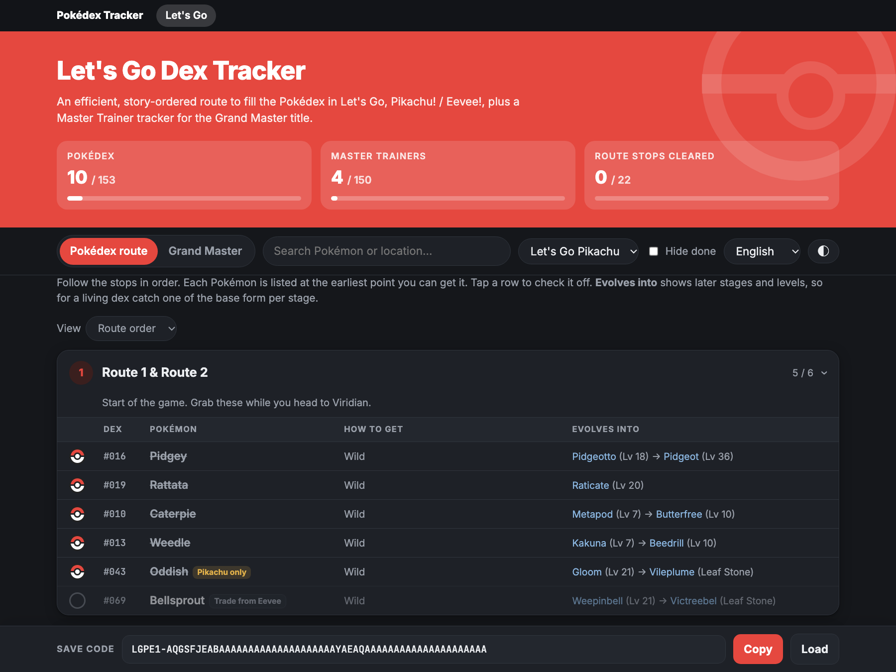

# Pokédex Tracker

Free, single-page completion trackers for the main series Pokémon games. Each game gets a story-ordered Pokédex route, plus tabs for its endgame goals. No account and no install.

**▶ Use it here:** https://mostafarlotfi.github.io/pokedex-tracker/

## Games

| Game | Tracker | Tabs |
| --- | --- | --- |
| Pokémon: Let's Go, Pikachu! / Let's Go, Eevee! | [Open](https://mostafarlotfi.github.io/pokedex-tracker/letsgo/) | Pokédex route · Grand Master (all 153 Master Trainers) |
| Pokémon Legends: Z-A (+ Mega Dimension DLC) | [Open](https://mostafarlotfi.github.io/pokedex-tracker/za/) | Pokédex route (232 Lumiose + 132 Hyperspace, with a Wild Zone view) · Mega Stones (all 92) |
| Pokémon Scarlet & Violet (+ The Teal Mask, The Indigo Disk) | [Open](https://mostafarlotfi.github.io/pokedex-tracker/sv/) | Pokédex route (664 Pokémon across the Paldea, Kitakami and Blueberry dexes, with an area view) · Ominous Stakes (all 32) |
| Pokémon Legends: Arceus | [Open](https://mostafarlotfi.github.io/pokedex-tracker/la/) | Pokédex route (all 242, with an area view) · Spiritomb wisps (all 107) · Unown (all 28) |
| Pokémon Brilliant Diamond & Shining Pearl | [Open](https://mostafarlotfi.github.io/pokedex-tracker/bdsp/) | Pokédex route (Sinnoh 151 and National 493, with the Grand Underground and an area view) · Ramanas Park legendaries |

Use the game menu at the top of any page to switch games. Games are listed from newest release to oldest.

## Features

- **Story-ordered Pokédex route.** Every entry is grouped into stops in story order and listed at the earliest point you can get it, with how to get it and its evolution chain (levels and methods). Switch to a plain list sorted by dex number at any time.
- **Endgame goals.** Each game has extra tabs for its post-game challenges. For Let's Go that's the Grand Master title: every Master Trainer with their location, sortable by dex number or grouped by place, so you can see who's left at each stop. For Legends: Z-A it's the Mega Stones, sortable by Pokémon or grouped by where you get them. For Scarlet & Violet it's the 32 Ominous Stakes that unlock the Treasures of Ruin. For Legends: Arceus it's the 107 Spiritomb wisps and the 28 Unown. For Brilliant Diamond & Shining Pearl it's the Ramanas Park legendaries.
- **Legends: Z-A extras.** A Wild Zone view lists every zone's Pokémon with how many you still need, so you can clear a zone in one visit. A toggle hides the Mega Dimension DLC for players who don't have it.
- **Version-aware.** Pick your version and the other version's exclusives are labeled "Trade from…".
- **Seven languages.** English, 日本語, Français, Deutsch, 한국어, 繁體中文 and 简体中文, with the official Pokémon names. Search works in the chosen language and in English. Your language and light/dark choice carry across every game.
- Search, hide finished entries, light/dark mode, and a layout that works on a phone.

## Saving your progress

Each game page has a **save code** in the bar at the bottom, for example `LGPE1-AQGSFJEA…` for Let's Go. It holds everything you've checked off in that game and updates every time you tick a box.

1. Tap **Copy** and paste the code into a notes app on your phone or computer (Apple Notes, Google Keep, anything).
2. To pick up where you left off, on any device or browser, open that game's page, tap **Load**, paste the code and tap **Restore**.

**Tracking several games?** Your progress in each game is kept when you switch games with the menu. Tap **Copy all games** (in any game's save bar, or on the front page) to copy every game's code at once, and keep that in your notes. To restore, paste the whole block into **Load** (or the box on the front page) and every game comes back.

The page also remembers your progress in the browser you're using, but that copy is lost if you clear your browser data or switch devices. The code in your notes is your backup, so copy it again after each play session. Every game has its own code, so progress never mixes between games.

## How the site is organized

- `index.html` is the game picker.
- Each game lives in its own folder (`letsgo/index.html`) as one self-contained page: all CSS, JavaScript and data inline, no build step.
- Every page has the same game menu at the top, listing games from newest release to oldest. When a game is added, it goes into that menu on every page (in release order) and gets a card on the picker.
- Each game's save code has its own prefix (`LGPE1-` for Let's Go, `PLZA1-` for Legends: Z-A, `PSV1-` for Scarlet & Violet, `PLA1-` for Legends: Arceus, `PBDSP1-` for Brilliant Diamond & Shining Pearl). Each code has a fixed length, which is how **Load** picks several codes out of one paste. The bit order inside a code never changes; a format change means a new prefix, and the old one keeps loading.
- Language and theme are shared across pages through `dex-lang` and `dex-theme` in browser storage.

This project grew out of [letsgo-dex-tracker](https://github.com/MostafaRLotfi/letsgo-dex-tracker), which stays online at its old address.

## Sources

Let's Go locations were cross-checked from [Thonky](https://www.thonky.com/pokemon-lets-go/list-of-pokemon-locations) and [PokéCommunity Daily](https://daily.pokecommunity.com/2018/11/16/pokemon-lets-go-pikachu-and-eevee-dex-locations-and-more/). Master Trainer data comes from [Bulbapedia](https://bulbapedia.bulbagarden.net/wiki/Master_Trainer), [SuperCheats](https://www.supercheats.com/lets-go-pikachu/walkthrough/where-are-all-the-master-trainers) and [GamerGuides](https://gamerguides.com/pokemon-lets-go-pikachu-and-lets-go-eevee/guide/postgame/master-trainers). Legends: Z-A locations, evolutions, gifts and Mega Stones come from [Serebii](https://www.serebii.net/legendsz-a/). Scarlet & Violet locations and evolutions come from [Serebii](https://www.serebii.net/scarletviolet/), wild levels (used to place each Pokémon on the route) from [pokestop.io](https://pokestop.io/location/paldea), and stake areas from [iMore](https://www.imore.com/gaming/nintendo-switch/pokemon-scarlet-and-violet-legendaries-all-32-ominous-stake-locations-and-how-to-catch-each-legendary-pokemon). Legends: Arceus locations, evolutions, wisps and Unown come from [Serebii](https://www.serebii.net/legendsarceus/). Brilliant Diamond & Shining Pearl locations, Grand Underground spawns, evolutions and Ramanas Park come from [Serebii](https://www.serebii.net/brilliantdiamondshiningpearl/). Pokédex order and localized Pokémon, item, move, type and place names come from [PokeAPI](https://pokeapi.co/).

Spot an error? Open an issue.

*Fan-made project, not affiliated with Nintendo, Game Freak, Creatures Inc. or The Pokémon Company.*
